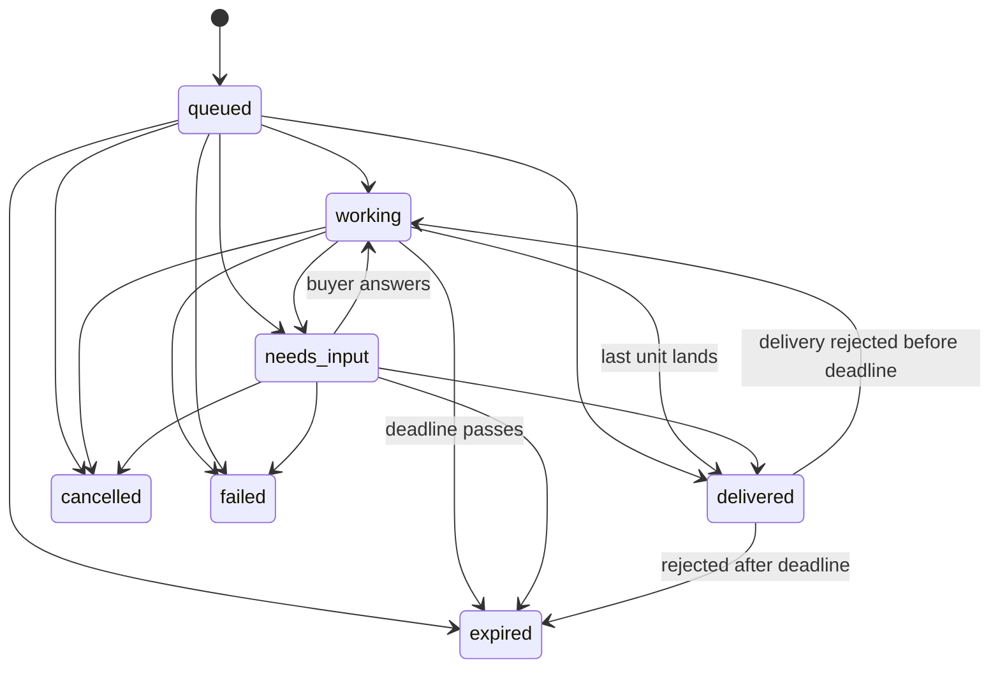

# Outcome API — spec v0.1

The caller states a goal, constraints and budget. The server quotes it, works on it asynchronously, and bills only on delivery.

No new protocol: HTTPS + JSON, webhooks/SSE for events, exposed over MCP and A2A so existing agents can call it today. One JSON Schema (`/schemas/outcome.json`) defines every object.

## 1. Primitives

| Primitive | What it is | Example |
|---|---|---|
| **Intent** | Goal + constraints + max spend | 20 meetings, UK fintech, CFO/COO, max £375 each |
| **Quote** | Server's answer: feasibility, price, ETA, terms | Partial: likely 14 in 30 days, £375 each |
| **Task** | Long-running job with state and an event log | `queued → working → needs_input → delivered` |
| **Delivery** | One unit of outcome + evidence + conformance checks | Meeting booked, calendar invite, source trail |
| **Settlement** | Billing record for an accepted delivery | £375 invoice item, auto-accepted 72h after the meeting |
| **Mandate** | Scoped, expiring spend delegation from a human to an agent | ≤ £2k, GB fintech only, until 31 Oct |

Amounts are integers in minor units (`37500` = £375). Timestamps are ISO 8601 UTC.

## 2. Flow

```
owner ── POST /v1/mandates ──────────────► mandate + agent key (shown once)
agent ── POST /v1/quotes   {intent} ─────► quote (nothing reserved)
agent ── POST /v1/tasks    {quote_id} ───► task: queued   (reserves qty × unit on the mandate)
server … works …  events → SSE / webhooks
server ── needs_input ───► agent POST /v1/tasks/{id}/input
server ── delivery.created ► agent accepts / rejects inside the window, or silence = accept
accepted ─► settlement ─► Stripe invoice item
```

## 3. Intent

```json
{
  "outcome": "meeting.booked",
  "quantity": 20,
  "constraints": { "geo": ["GB"], "industries": ["fintech"], "titles": ["CFO", "COO"] },
  "budget": { "currency": "gbp", "max_unit_price": 37500, "max_total": 750000 },
  "deadline": "2026-11-18T09:00:00Z",
  "brief": "Embedded lending for UK fintechs."
}
```

- `outcome` picks a capability (`GET /v1/capabilities`). Each capability publishes its own `constraints` and `result` schemas.
- `deadline` defaults to the capability's window (30 days for meetings).

## 4. Quote

- `feasibility.status`: `feasible` (likely ≥ requested), `partial` (0 < likely < requested), `infeasible` (price above budget, total above `max_total`, deadline inside the ramp, or no capacity). `reasons[]` always says why.
- `price.unit_amount` is locked once a task is created from the quote.
- `eta`: `first_delivery_by`, `deadline`, `full_quantity_by` (when the full quantity would land at the current rate).
- `terms`: `billing: per_accepted_unit`, `acceptance_window_hours`, `acceptance_anchor` (`delivered_at` or `occurs_at`), `reject_reasons[]`.
- For agent keys, `mandate_check` says before commit whether the mandate covers it, and the max affordable quantity.
- Quotes expire after 24h and convert to at most one task.

## 5. Task lifecycle



- `progress`: `pending` (awaiting acceptance), `accepted`, `rejected`, `remaining`.
- `billing.committed`: most the task can still cost. Starts at `quantity × unit`; on a terminal state it drops to `settled + pending × unit`.
- `billing.settled`: total of accepted units.
- Expired is not failure: the buyer pays for what was accepted and nothing else.

## 6. Delivery and acceptance

A delivery carries `result` (capability schema), `evidence[]` (`calendar_invite`, `email_thread`, `call_recording`, `transcript`, `crm_record`, `source`, `other`, each with optional `uri` and `sha256`) and server-computed `checks[]` (`pass` / `warn` / `fail`).

- Any `fail` check refuses the delivery with `422 delivery_nonconforming`. The buyer never sees off-contract work.
- `warn` checks are shown to the buyer (e.g. title is "VP Finance" against a CFO/COO ask).
- The buyer accepts or rejects (`reason_code`) while `status = pending_acceptance`.
- At `acceptance_window_ends_at` the delivery auto-accepts. For `acceptance_anchor = occurs_at` the window starts when the outcome happens (meeting end), not at booking, so no-shows can be rejected.
- A rejection frees the slot: `delivered` reopens to `working` if the deadline hasn't passed.

## 7. Settlement

One settlement per accepted delivery, created in the same transaction as the acceptance. A payment provider then charges it, idempotently on the settlement id:

- `ledger`: records only.
- `stripe`: creates an invoice item on the account's customer (`Idempotency-Key: outcome_<settlement id>`). Items roll into the next invoice.

Failed charges retry with backoff (1m, 10m, 1h, 6h, 24h) and emit `settlement.failed` with `will_retry`.

## 8. Mandates

- Created by the account **owner** key only. Optionally returns an **agent key** bound to that mandate.
- `scope`: `outcomes[]`, `currency`, `max_total`, optional `max_unit_price`, optional `constraints` envelope:
  - array → allow-list; the intent's values must be a non-empty subset
  - `{min, max}` → the intent's range must sit inside
  - scalar → must match
- Committing reserves `quantity × unit` under a row lock. Concurrent commits can't overspend.
- Invariant: `reserved = Σ(task.committed − task.settled)`, `spent = Σ task.settled`, `remaining = max_total − spent − reserved`.
- Errors: `402 mandate_budget_exceeded` (with `max_affordable_quantity`), `403 mandate_scope_violation` (with `violations[]`), `403 mandate_inactive`.
- **Expiry** stops new commitments; in-flight tasks stay manageable. **Revocation** also kills the mandate's agent keys.

## 9. Roles

| Role | Key from | Can |
|---|---|---|
| owner | `POST /admin/accounts` | Everything for the account; create/revoke mandates; commit without a mandate |
| agent | `POST /v1/mandates` | Quote, commit (inside its mandate only), manage its own tasks and deliveries |
| operator | `POST /admin/operator-keys` | Fulfilment: start, request input, deliver, fail |

## 10. Events

`task.created`, `task.status_changed`, `task.input_required`, `task.input_received`, `delivery.created`, `delivery.accepted`, `delivery.rejected`, `settlement.succeeded`, `settlement.failed`.

Every event has a per-server monotonic `seq`. Three ways to consume them:

1. **Poll** `GET /v1/tasks/{id}/events?after=<seq>`
2. **SSE** same URL with `Accept: text/event-stream`; `id:` is the seq, resume with `Last-Event-ID`. Streams close after `timeout` seconds (default 25); reconnect.
3. **Webhooks** to the task's `callback_url` (and to `OPERATOR_WEBHOOK_URL` for the fulfilment side). Written to an outbox in the same transaction as the change, delivered at least once, retried with backoff (30s → 6h). Dedupe on `Outcome-Event-Id`.

Signature header: `Outcome-Signature: t=<unix>,v1=<hex HMAC-SHA256(secret, "<t>.<raw body>")>`. Reject if `|now − t| > 300s`.

## 11. Idempotency

Every POST accepts `Idempotency-Key`. Same key + same body replays the first response (`Idempotent-Replayed: true`), including 4xx errors. Same key + different body → `422 idempotency_mismatch`. Concurrent duplicate → `409 idempotency_in_progress`.

## 12. Bindings

| Surface | Endpoint |
|---|---|
| REST | `/v1/*`, described by `/openapi.json` (OpenAPI 3.1) |
| JSON Schema | `/schemas/outcome.json` |
| MCP (Streamable HTTP, stateless) | `POST /mcp`. Tools: `list_outcomes`, `get_quote`, `create_task`, `get_task`, `list_tasks`, `respond_to_input`, `accept_delivery`, `reject_delivery`, `cancel_task`, `get_mandate` |
| A2A 0.3 (JSON-RPC) | Card at `/.well-known/agent-card.json`, endpoint `POST /a2a`. `message/send` with a DataPart `{"action": "quote" \| "create_task" \| "respond_input" \| "accept_delivery" \| "reject_delivery", ...}`; `tasks/get`; `tasks/cancel`. Task states map `queued→submitted`, `needs_input→input-required`, `delivered→completed`; deliveries are artifacts |

All use the same Bearer key.

## 13. Errors

`{"error": {"code", "message", "details?"}}`

| Status | Code |
|---|---|
| 400 | `invalid_request` (details = field tree) |
| 401 | `unauthorized` |
| 402 | `mandate_budget_exceeded` |
| 403 | `forbidden`, `mandate_scope_violation`, `mandate_inactive` |
| 404 | `not_found` (also for other tenants' and other mandates' objects) |
| 409 | `invalid_state`, `quote_expired`, `quote_infeasible`, `quote_already_accepted`, `idempotency_in_progress` |
| 422 | `delivery_nonconforming`, `idempotency_mismatch` |

## 14. Adding an outcome

Implement `Capability` (`src/core/capabilities/types.ts`):

- `constraints` / `result`: zod schemas (become JSON Schema, OpenAPI, MCP and A2A docs automatically)
- `assess(intent)`: unit price, daily rate, ramp days, reasons
- `check({intent, result, evidence, prior})`: conformance checks
- `occursAt(result)`, `summarize(result)`, `terms`, `example`

Register it in `defaultCapabilities()`.
